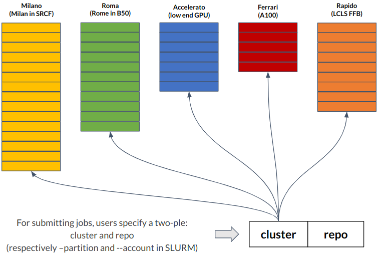
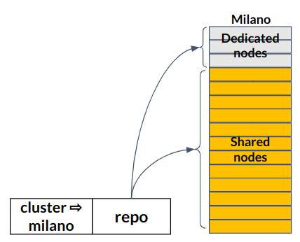

# Batch Compute

## Slurm

Slurm is a batch scheduler that enables users to submit compute jobs
of varying scope to our compute clusters. It will queue up jobs such
that the compute resources available in S3DF are fairly and
efficiently shared and distributed for all users. This page describes
S3DF specific Slurm information. If you haven't used Slurm before, you
can find general information on using this workflow manager in our
[Slurm Guide](slurm.md).

## Clusters and Repos

A [Cluster](coact.md#cluster) is a homogeneous set of computing nodes with the same
hardware specifications and the same access to the storage. A
[Facility](coact.md#coact) is an entity (organization, project,
group, program, etc) whom owns resources within S3DF. A [Repo](coact.md#repos) is a set
of resources associated with a group of people within a facility -
e.g., an LCLS experiment, a cryo-EM experiment, an effort within the
accelerator directorate, etc.

Typically, a Facility will acquire hardware in order to own resources
within S3DF, but resources can also be assigned by SLAC. [Talk with
us](contact-us.md) if you don't have funds to buy hardware but you
would like to use dedicated resources within the S3DF.

### Partitions & Accounts :id=partitions-amp-accounts

For submitting jobs, you need to specify a two-ple: the cluster
(`partition` in Slurm terminology) and the Repo (`account` in
Slurm). These two parameters indicate, respectively, which hardware to
use and which Repo to charge for that particular job. You can use [Coact](https://coact.slac.stanford.edu) to determine
what S3DF resources you have access to and how much has been used.



Each Repo can have one of three stances in relation to a specific
cluster:

1. Reservation: for repos with real time requirements or with
  uniform usage over time (for that cluster). A subset of super-users
  from each facility will be allowed to create reservations. Users
  will submit jobs for this stance using the repo name and reservation
  name. For example:
  `--partition milano --account lcls:xpp1234 --reservation lcls:xpp1234-230101-230105`

2. Allocation: for repos within their allocation quota (for
  that cluster). This is the default stance and users will submit jobs
  for this stance using the repo name. For example:
  `--partition milano --account lcls:xpp1234`.
  These jobs are limited by two things: the Repo's own allocation, and
  a node limit on that cluster that is shared by every Repo in the
  Facility. This means a job may wait in the queue even though your
  Repo is under its allocation, if the rest of your Facility is
  already using its share of the cluster.

3. Preemptable: for repos above their quota or with no quota (for
  that cluster). Jobs in this category may be preempted by higher
  priority jobs. This is the opportunistic cycles stance, aka
  scavenger cycles, and jobs are submitted under the repo name
  and quality of service preemptable. For example:
  `--partition milano --account lcls:xpp1234 --qos preemptable`.
  Preemptable jobs do not count against your Facility's node limit, so
  they can use any idle resources on the cluster; the trade-off is that
  they may be stopped to make room for other jobs.

| | `--qos normal` (default) | `--qos preemptable` |
| --- | --- | --- |
| Limited by | your Repo's allocation, and your Facility's shared node limit on the cluster | only what is free on the cluster |
| Can be preempted | No | Yes |
| Needs an allocation on the cluster | Yes | No |
| Account shown in `squeue`/`sacct` | `<facility>:<repo>@<partition>` | `<facility>:<repo>@<partition>^preemptable` |

As a matter of convention:

- Default Slurm account = `<facility>`
- Repo Slurm account = `<facility>:<repo>`
- Slurm reservation = `<facility>:<repo>-<starttime>-<endtime>`

The mapping of repos to dedicated resource is dynamic. This is
required, for example, to assign different nodes to a repo so that a
rolling upgrade does not cause an outage for stance 1, or to change
the amount of resources dedicated to real-time and fast-feedback
activities within a cluster to match the actual requirements of a
running experiment.



#### Repos without an allocation on a cluster

If your Repo has no allocation on the cluster you submit to, it can
only run preemptable jobs there. Submitting with `--qos normal` will be
rejected with a message like:

```
account rubin:myrepo@milano has no allocation on this partition, so qos=normal is not allowed; submit with --qos=preemptable
```

As with any job, if you do not specify `--qos`, Slurm uses your
account's default QoS. For a Repo without an allocation on the
cluster, that default is `preemptable`, and Slurm prints a notice
saying the job is running as preemptable.

#### Account names in `squeue` and `sacct`

You always submit with `--account <facility>:<repo>`, but Slurm
records the job under a more specific name that includes the cluster,
and for preemptable jobs a `^preemptable` suffix. For example, a job
submitted with `--partition milano --account rubin:myrepo` shows up as
`rubin:myrepo@milano`, or `rubin:myrepo@milano^preemptable` if it is
preemptable. Use the full name when filtering, e.g.
`sacct --account rubin:myrepo@milano`. Submitting with only
`--account <facility>` still uses the Facility's default Repo,
`<facility>:default`.


### Batch Clusters

See the table below to determine the specifications for each cluster (slurm partition).

| Partition name | CPU model | Useable cores per node | Useable memory per node | GPU model | GPUs per node | Local scratch | Number of nodes |
| --- | --- | --- | --- | --- | --- | --- | --- |
| torino | AMD Turin 9555 | 120 | 720 GB | - | - | 6 TB | 52 |
| hopper | AMD Turin 9575F | 224 (hyperthreaded) | 1344 GB | NVIDIA H200 | 4 | 21 TB | 3 |
| roma | AMD Rome 7702 | 120 | 480 GB | - | - | 300 GB | 131 |
| milano | AMD Milan 7713 | 120 | 480 GB | - | - | 6 TB | 270 |
| ampere | AMD Rome 7542 | 112 (hyperthreaded) | 952 GB | Tesla A100 (40GB) | 4 | 14 TB | 42 |
| turing | Intel Xeon Gold 5118 | 40 (hyperthreaded) | 160 GB | NVIDIA GeForce 2080Ti | 10 | 300 GB | 27 |
| ada | AMD Genoa 9454 | 72 (hyperthreaded) | 702 GB | NVIDIA L40S | 10 | 21 TB | 19 |

### Resource Restrictions

Each slurm Account will have limitations set according to it's associated Coact Repo's [compute Allocation](coact.md#compute-allocation). Please contact your Facility Czar for information.

The [Coact](coact.md) system keeps track of the compute time spent by each Facility on
each Cluster. If a Facility keeps using more than it has acquired on a cluster (see [Compute Allocation](coact.md#compute-allocation)),
the normal jobs of all of its Repos on that cluster are held: they are still accepted, but stay pending
until the Facility's usage drops. Preemptable jobs are not affected.


### Slurm Features and Constraints

Batch nodes at S3DF have specific features (or labels) assigned which define certain characteristics of the nodes. Users can specify which of those features are required by their jobs using the slurm `constraint` options in their job submission. Only nodes with that match these defined contained/features will run the job.

Multiple constraints may be specified during job submission. Please refer to the [official documentation](https://slurm.schedmd.com/sbatch.html) for more information. 


#### High-Memory Milano Nodes

Batch nodes that belong in the same partition have homogeneous software and hardware. However, for the `partition=milano`, S3DF supports some subtle hardware differences. High-memory Milano nodes allow preemptable jobs by from any user by default, even if the user does not explicitly specify the constraint identifying those nodes during job submission. This policy maximizes CPU usage and prevents the creation of small silos in the S3DF cluster.

To run jobs specifically on high-memory nodes, you must submit the jobs using the corresponding constraint of `MEM_SZE:1920GB`. Only facilities whom have procured such nodes may run `qos=normal` jobs on these nodes:

```
# sbatch --constraint="MEM_SZE:1920GB" ...
```

or include the same option in an `srun` script.

?> If your facility does not own any high-memory nodes, then any attempt to submit `qos=normal` jobs to high-memory nodes will fail.
