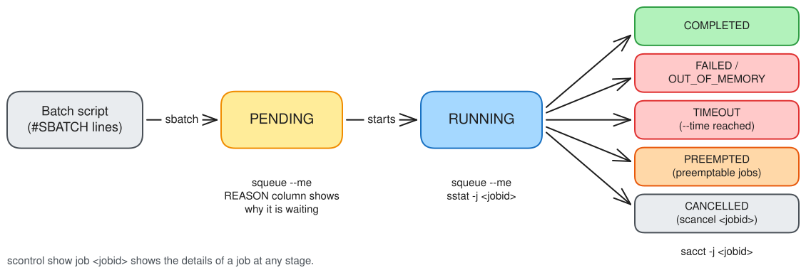

# Slurm
The official Slurm documentation can be found at the [SchedMD
site](https://slurm.schedmd.com/documentation.html). For S3DF specific
information (partitions, accounts and limits), see [Batch Compute](batch-compute.md).

## Why should I use Batch?

Whilst your desktop or laptop computer has a fast processor and quick access to data stored on its local hard disk/ssd; you may want to run large compute tasks that require more CPU/GPU/memory to run, or to process a large amount of data. Our compute servers are part of a Batch system that allows you to accomplish such tasks in a reasonable amount of time. Our servers also have fast access to centralised storage, have widely-used, common software packages and images pre-installed, and will enable you to run these larger compute tasks without impacting your own local desktop/laptop resources.

## Why should I use Slurm?

Slurm is the batch scheduler used at S3DF. It is widely used across academic and laboratory computing facilities, so what you learn here will carry over to many other sites, and scripts written for other Slurm clusters usually need only small changes (mainly the partition and account) to run at S3DF.

## What should I know about using Batch?

The purpose of a batch system is to enable efficient sharing of the CPUs, GPUs, memory, and ephemeral storage that exists in a compute Cluster. The cluster is comprised of many servers - often called batch nodes. As the number of these batch nodes and their resources (such as GPUs) in our environment is finite, we need to keep account of which users consume which resources so that we can provide access to all users in a fair manner.

## What is a Slurm Partition?
A partition is a logical grouping of batch nodes. These are servers of a similar technical specification (e.g. the same CPU model, or the same GPU model). Examples of partition names are `milano`, `roma` and `ampere`; see [Batch Clusters](batch-compute.md#batch-clusters) for the full list.


## How do I see the status of the available resources?

To view the status of the nodes on S3DF from the command line use [sinfo](https://slurm.schedmd.com/sinfo.html). The following produces a reasonably informative summary of all the nodes on S3DF:

```
sinfo --Node --format="%10N %.6D %10P %10T %20E %.4c %.8z %8O %.6m %10e %.6w %.60f"
```

To get only information on a specific partition use `--partition=<partition>`. To get more information on a specific node, use the following [scontrol](https://slurm.schedmd.com/scontrol.html) command:

```
scontrol show node <node name>
```

The names of the nodes are shown in the left-most column (NODELIST) of the above `sinfo` command.


## How do I use Slurm?
There are two ways to interact with slurm

- Using command line tools on the interactive pools.
- Using the ondemand web interface.

Common actions that you may want to perform are:

| | | |
|--- |--- |--- |
| Submit a job | `srun` or `sbatch` | request a quick job to be run - e.g. an interactive terminal with `srun`, and longer job(s) with `sbatch` |
| List your jobs | `squeue --me` | shows your pending and running jobs, and why pending jobs are waiting |
| Show information about a job | `scontrol show job <jobid>` | shows detailed information about the state, resources requested etc. for a job |
| Cancel or terminate a job | `scancel <jobid>` | cancel a job; you can also use `--signal=INT` to send a unix signal to the job to cleanly terminate |
| Show your job's priority | `sprio` | shows the fairshare calculations that determine your place in line for the job to start |
| Show running statistics about a job | `sstat` | show job usage details |
| Show past jobs | `sacct` | show accounting information for completed jobs |
| List the accounts you can use | `sacctmgr show associations user=$USER format=Account%40,QOS%30` | shows the Slurm accounts and QoS you may submit with. Repo membership itself is managed in [Coact](coact.md) |


## How do I submit a Batch Job?

In order to submit a batch job, you have to:

1. [create a text file containing some slurm commands](#create-a-batch-script) (lines starting with `#SBATCH`) and a list of commands/programs that you wish to run. This is called a batch script.
2. [submit this batch script](#submit-the-job) to the cluster using the `sbatch` command
3. [monitor the job](#monitor-job-progress) using `squeue --me`



### Create a Batch Script

Create a job submission script (text file) `script.sh` (or whatever filename you wish):

```
#!/bin/bash

#SBATCH --partition=ampere
#SBATCH --account=<facility>:<repo>
#
#SBATCH --job-name=test
#SBATCH --output=output-%j.txt
#SBATCH --error=output-%j.txt
#
#SBATCH --ntasks=1
#SBATCH --cpus-per-task=12
#SBATCH --mem-per-cpu=1g
#
#SBATCH --time=0-00:10:00
#
#SBATCH --gpus 1

<commands here>

```

In the above example, we write a batch script for a job named 'test' (using the `--job-name`). You can choose whatever name you wish to give the job so that you may be able to quickly identify it yourself. Both stdout and stderr will be written to the same file `output-%j.txt` in the current working directory - `%j` will be replaced with the slurm job id (using the `--output` and `--error` options). We request a single Task (think of it as an MPI rank) and that single task will request 12 CPUs; each of which will be allocated 1GB of RAM - so a total of 12GB. By default, the `--ntasks` will be equivalent to the number of nodes (servers) asked for. In order to aid scheduling (and potentially prioritising the Job), we limit the [duration of the Job](#specifying-how-long-the-job-should-run-for) to 10 minutes. The format of the time limit field is `D-HH:MM:SS`. We also request a single [GPU](#how-can-i-request-gpus) with the Job, which is why the job runs on the `ampere` (GPU) partition. The GPU will be exposed via `CUDA_VISIBLE_DEVICES`.

?> __TIP:__ only lines starting with `#SBATCH ` will be processed by slurm. As the script itself is just a bash script, any line beginning with `#` will be ignored by bash. As such you may also comment out slurm directives by using something like `##SBATCH`

We can define [where the job will run](#what-is-a-slurm-partition) using the `--partition` option, and which Repo the job is charged to using the `--account` option. See [Partitions & Accounts](batch-compute.md#partitions-amp-accounts) for how accounts, allocations and the `normal`/`preemptable` QoS work at S3DF.

?> You can think of the batch script as a shell script but with some extra directives that only slurm understands. As such, you can also just run the same script on the command line to check that your job will work; i.e. `sh script.sh` will run the same set of commands but on the local host. This also means that if you already have a shell script that runs your code, you can 'slurmify' it by adding slurm directives with `#SBATCH`. Please note, however, that if you are using GPUs in your code etc. the login node may not have any GPUs and hence your local run will fail.


### Specifying how long the job should run for
It is important that you specify a meaningful duration for which you expect your job to run. This allows the slurm scheduler to appropriately prioritize your job against other jobs that are competing for the limited resources in the cluster. The duration of a job may depend upon many different factors such as the type of hardware that you may be constraining your job to run against, how well your code/application scales with multiple nodes, the speed of memory and disk access etc.

You can specify the expected duration with the `--time` option. Valid time formats are:

```
M (M minutes)
M:S (M minutes, S seconds)
H:M:S (H hours, M minutes, S seconds)
D-H (D days, H hours)
D-H:M (D days, H hours, M minutes)
D-H:M:S (D days, H hours, M minutes, S seconds)
```

Once the job exceeds the specified job time, it will terminate. Unless you checkpoint your application as it progresses this may result in wasted cycles and the need to submit the job again with a longer duration.


### Specifying CPU requirements
- `--ntasks=<n>`: the number of tasks (processes, e.g. MPI ranks) to run.
- `--cpus-per-task=<n>`: the number of CPUs each task needs, e.g. for multi-threaded code.
- `--nodes=<n>`: the number of nodes (servers) to spread the tasks over.

The number of usable cores per node for each partition is listed in [Batch Clusters](batch-compute.md#batch-clusters).

### Specifying memory requirements
- `--mem=<size>`: the memory needed per node, e.g. `--mem=16g`.
- `--mem-per-cpu=<size>`: the memory needed per allocated CPU, e.g. `--mem-per-cpu=1g`.

Use one or the other, not both. Your job will be terminated if it uses more memory than it requested. The usable memory per node for each partition is listed in [Batch Clusters](batch-compute.md#batch-clusters).

### Specifying nodes with specific resources (constraints)
Use `--constraint=<feature>` to only run on nodes that have a given feature, e.g. `--constraint="MEM_SZE:1920GB"`. You can list the features of each node with `sinfo --Node --format="%N %f"`. See [Slurm Features and Constraints](batch-compute.md#slurm-features-and-constraints) for the features that matter at S3DF, and for constraints S3DF may add to your job automatically.

### Specifying a reservation
If your Repo has a reservation, submit to it with `--reservation=<reservation name>` alongside your usual `--partition` and `--account`. See [Partitions & Accounts](batch-compute.md#partitions-amp-accounts) for how reservations are named.


## Submit the job
After you have [created a batch script](#create-a-batch-script), you then need to tell slurm to queue it so that it may run. The command to use is `sbatch`. Therefore to submit the script `script.sh` we simply run

```
sbatch script.sh
```

If successful, it should provide you with the job id that the script will run as. You can use this job id to [monitor your job progress](#monitor-job-progress).

?> __TIP:__ you can also give the slurm directives directly on the command line rather than within the batch script. When given as arguments to `srun` or `sbatch`, they take precedence over the same directives in the batch script. e.g. if you run `sbatch --partition roma script.sh` and your script.sh specifies `--partition=milano`, your job will be submitted to the roma partition.


## Monitor job progress
You can monitor the progress of your jobs with

```
squeue --me
```

For a pending job, the last column (NODELIST(REASON)) shows why it has not started yet. Use `scontrol show job <jobid>` for more detail on a single job, and `sacct` to see jobs that have already finished.

You can cancel a job with

```
scancel <jobid>
```

## How can I request GPUs?

You can use `--gpus` to specify GPUs for your jobs: using a number will request that many of any GPU available on the partition that you choose. The type of GPU you get will depend upon the partition (cluster) that you request.

```
# request single gpu
srun -A <facility>:<repo> -p ampere -n 1 --gpus 1 --pty /bin/bash
```

## How can I see what GPUs are available?

```
sinfo -o "%12P %5D %14F %7z %7m %10d %11l %42G %38N %f"
```

This prints one line per partition. The `GRES` column shows the type and number of GPUs per node (as `gpu:<type>:<count>`), and `NODES(A/I/O/T)` shows how many nodes are allocated, idle, other (e.g. down) and in total. See [Batch Clusters](batch-compute.md#batch-clusters) for a summary of the GPU partitions.


## Why is My Job taking a long time to start?

This is often due to limited resources. The simplest way is to request fewer CPUs (`--cpus-per-task`) or less memory (`--mem`) for your Job. However, this will also likely increase the amount of time that you need for the Job to complete. Note that perfect scaling is often very difficult (i.e. using 16 CPUs will not run twice as fast as 8 CPUs, nor will using 4 nodes via MPI run twice as fast as 2 nodes), so it may be beneficial to submit many smaller Jobs if your code allows it. You can also set the `--time` option to specify that your job will only run up to that amount of time so that the scheduler can better fit your job in.

If your Repo still has allocation to spare but your jobs stay pending, your Facility may already be using its full share of the cluster: all Repos in a Facility share a single node limit for normal jobs. `squeue` will show a pending reason starting with `AssocGrp` in this case.

You can also submit with `--qos preemptable` so that your job may run on any idle resources at SLAC, without counting against your Facility's limit. This, however, has the disadvantage that should higher priority jobs need the same resources, your jobs may be terminated (preempted) - possibly before they have completed. See [Partitions & Accounts](batch-compute.md#partitions-amp-accounts) for details.
